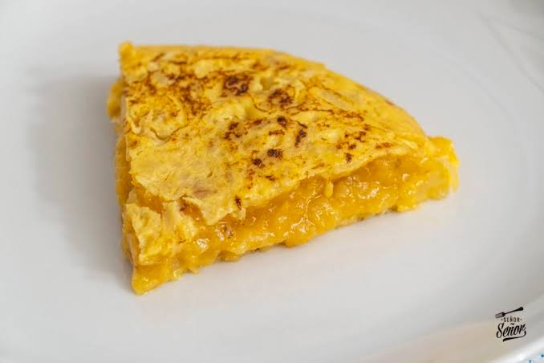

>Lois Calvo Caamaño
>``1º BACH A``
*5/11/26*
# Receta da tortilla
 Ingredientes:

- Ovo
- Sal
- Patatas
- Cebola

### Modo de realización
1- Escacha y bate los huevos.

2- Pela las patatas.

3- Échalo todo en la sartén y ponle una mano de sal.

4- Remuevelo todo y ponle cebolla picada.

5- Espera a que se haga y dale la vuelta 2 veces.

Entra aqui o meu blog:
https://loisccticsbaio2627.wordpress.com/
